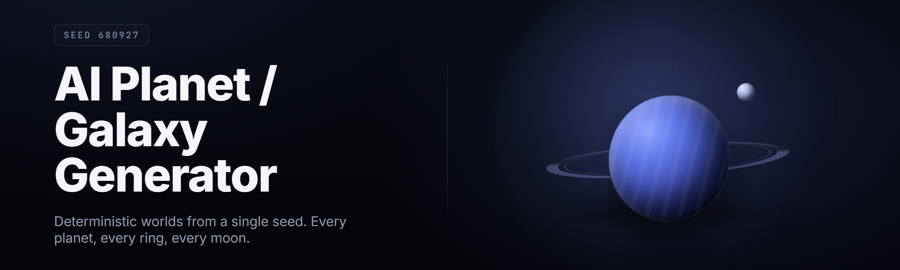

  
  
  

  

  
  
  

---

**Procedural universe engine. One `.exe`. Infinite worlds. No Python. No dependencies.**

A desktop generator that turns a prompt, a seed, or a sliders-panel into a fully rendered planet, star system, or galaxy — complete with biomes, atmospheres, orbital mechanics, and exportable lore. Built for worldbuilders, TTRPG GMs, sci-fi writers, and anyone who needs a solar system at 2 AM.

---

## 📋 Table of Contents

- [Overview](#-overview)
- [What is AI Planet / Galaxy Generator?](#-what-is-ai-planet--galaxy-generator)
- [Key Features](#-key-features)
- [The Problem](#-the-problem)
- [The Solution](#-the-solution)
- [Quick Start](#-quick-start)
- [Comparison](#-comparison)
- [Module Catalog](#-module-catalog)
  - [🌍 Planet Generation Modules](#-planet-generation-modules)
  - [🌌 Galaxy & Star System Modules](#-galaxy--star-system-modules)
  - [🎨 Rendering & Visual Modules](#-rendering--visual-modules)
  - [🧠 AI & Prompt Modules](#-ai--prompt-modules)
  - [📤 Export & Integration Modules](#-export--integration-modules)
  - [⚙️ Engine & Runtime Modules](#️-engine--runtime-modules)
- [Usage Guidelines](#-usage-guidelines)
- [Compatibility / Platform Support](#-compatibility--platform-support)
- [System Requirements](#-system-requirements)
- [Installation](#-installation)
- [Known Issues](#-known-issues)
- [Module Status Board](#-module-status-board)
- [FAQ](#-faq)

---

## 🧭 Overview

| Category | Details |
| --- | --- |
| **Product** | AI Planet / Galaxy Generator |
| **Type** | Standalone Windows desktop application (`.exe`) |
| **Release** | v2.4.1 — 2026 build channel |
| **Core engine** | Procedural noise + transformer-guided prompt synthesis |
| **Output** | Rendered PNG/TIFF maps, JSON world files, GLTF meshes, lore markdown |
| **Offline** | Full offline generation; optional cloud model pack for prompt expansion |
| **Distribution** | GitHub release page → landing page → direct `.exe` download |

The generator ships as a single self-contained `.exe`. You do not install Python, Node, or a build toolchain. You extract, you run, you get a universe. Everything that a worldbuilder would otherwise stitch together from five different tools — terrain noise, biome assignment, atmosphere shaders, orbital math, and naming — lives inside one window with tabs.

---

## 🌠 What is AI Planet / Galaxy Generator?

| Term | Explanation |
| --- | --- |
| **Seed** | A 64-bit integer that deterministically reproduces an entire planet or galaxy. Same seed, same universe, every machine. |
| **Biome** | A climate + terrain classification (tundra, iron desert, methane swamp, silicate reef) assigned by the biome solver from temperature, pressure, and moisture fields. |
| **Orbital shell** | A radius band around a star where planets are placed. The generator fills shells rather than scattering points, which keeps systems physically plausible. |
| **Prompt synth** | The AI layer that expands a short phrase like *"dying red dwarf, three moons"* into a full parameter set. |
| **Lore pass** | The post-generation text stage that names continents, factions, and eras from the world's own parameters. |
| **Map stack** | The layered raster set (height, normal, albedo, cloud, night-light) exported per body. |
| **Galaxy template** | A macro shape — spiral, barred spiral, elliptical, irregular, ring — that seeds star placement across the disk. |

**Why people use it:**

- Generate a complete habitable world in under 4 seconds on a mid-range GPU.
- Reproduce any world exactly by sharing a single seed string.
- Export game-ready maps without opening a second program.
- Keep everything offline — no account, no telemetry, no cloud round-trip.
- Batch-generate 500 systems for a campaign or a novel outline in one click.

---

## ⭐ Key Features

| Feature | Description | Benefit |
| --- | --- | --- |
| Prompt-to-Planet | Type a description, get a fully parameterized world | Skips the manual slider grind |
| Deterministic Seeds | 64-bit seed encoding for every body | Shareable, reproducible worlds |
| Biome Solver | Physical climate model assigns biomes | Worlds that make internal sense |
| Orbital Mechanics | Real Keplerian placement and stability checks | No impossible systems |
| Galaxy Templates | 5 macro shapes, tunable arm count and pitch | Scale from one planet to a disk |
| Map Stack Export | Height, normal, albedo, cloud, night | Drops straight into Unity/Unreal |
| Lore Pass | Auto-names continents, factions, eras | Instant narrative scaffolding |
| Batch Mode | Generate 1–1000 systems headless | Campaign and novel prep |
| Mesh Export | GLTF spheres with displacement | 3D-print or import ready |
| Offline Core | No network needed for generation | Works on a plane, in a basement |

---

## 🧨 The Problem

- Most terrain tools generate **terrain**, not **worlds** — you still hand-place moons, stars, and climate.
- Procedural generators are either **too shallow** (random noise spheres) or **too heavy** (full game engines you must learn).
- Reproducing a world you liked last week is often impossible — no seed discipline.
- Exporting to a game engine means five intermediate programs and a broken normal map.
- Writing lore for 200 generated planets by hand is the actual bottleneck, not the geometry.
- Cloud-based generators stop working when the service dies or the API key expires.
- Nothing sits between "toy noise demo" and "weeks of Blender."

---

## 🛠️ The Solution

| Problem | Solution |
| --- | --- |
| Terrain tools don't build worlds | Full system generator: star, shells, moons, climate |
| Shallow or heavy tools only | Mid-weight `.exe`, no engine to learn |
| No reproducibility | Every body carries a shareable 64-bit seed |
| Painful engine export | One-click map stack + GLTF with correct normals |
| Lore bottleneck | Lore pass names everything from parameters |
| Cloud dependency | Fully offline core generation |
| Nothing in the middle | Ships as a single self-contained desktop app |

---

## 🚀 Quick Start

1. 🪐 Open the project page and grab the latest `.exe` from the release.
2. 📦 Extract the archive to any folder — no installer, no registry writes.
3. ▶️ Run the `.exe`. First launch unpacks model packs to `./packs`.
4. 🎛️ Pick a mode: **Planet**, **System**, or **Galaxy**. Type a prompt or paste a seed.
5. 💾 Hit **Generate**, then **Export** to drop maps, JSON, and lore into `./out`.

  

---

## ⚖️ Comparison

| Aspect | Typical Noise Tool | Full Game Engine | This Tool |
| --- | --- | --- | --- |
| Setup | Plugin install | Multi-GB engine | Single `.exe` |
| Scope | One terrain | Everything, manually | Planet → galaxy |
| Reproducibility | Manual | Manual | 64-bit seed |
| Climate model | None | Add-on | Built-in solver |
| Lore generation | None | None | Lore pass |
| Export formats | Height only | Engine-specific | PNG/TIFF/JSON/GLTF |
| Offline | Varies | Yes | Yes |
| Learning curve | Low | Steep | Low-mid |

---

## 🧩 Module Catalog

### 🌍 Planet Generation Modules

| Feature | Effect |
| --- | --- |
| Terrain Noise Stack | Multi-octave fBm + ridged + domain warp |
| Biome Solver | Assigns 14 biomes from climate fields |
| Atmosphere Model | Pressure, albedo, and greenhouse tuning |
| Hydrosphere Generator | Oceans, ice caps, salinity, tides |
| Tectonic Plates | Crust cells driving mountain belts |
| Moon Forge | Up to 6 moons with tidal locking |
| Ring System Builder | Ice/rock rings with density gaps |
| Impact Crater Pass | Distribution by age and size curve |

### 🌌 Galaxy & Star System Modules

| Feature | Effect |
| --- | --- |
| Galaxy Templates | Spiral, barred, elliptical, irregular, ring |
| Star Population | Spectral class distribution per region |
| Orbital Shell Filler | Keplerian placement with stability check |
| Habitable Zone Solver | Star-luminosity-based HZ banding |
| Asteroid Belt Gen | Kirkwood gap-aware belt placement |
| Nebula Painter | Volumetric dust lanes and emission |
| Binary & Trinary Stars | Multi-star barycenter handling |
| Stellar Age Model | Metallicity drift across the disk |

### 🎨 Rendering & Visual Modules

| Feature | Effect |
| --- | --- |
| Map Stack Renderer | Height, normal, albedo, cloud, night |
| PBR Material Bake | Roughness + metallic from biome |
| Cloud Layer Sim | Banded + convective cloud patterns |
| Night Lights | Population-driven emissive map |
| Displacement Mesh | GLTF sphere with real elevation |
| Starfield Backdrop | Parallax skybox for previews |
| Color Grading | Per-biome palette lock |
| Turntable Preview | Auto-orbit render for turntables |

### 🧠 AI & Prompt Modules

| Feature | Effect |
| --- | --- |
| Prompt Synth | Expands short phrases to full params |
| Seed Interpolator | Morph between two saved worlds |
| Lore Pass | Names continents, factions, eras |
| Style Transfer | Push biomes toward a reference look |
| Constraint Solver | "No gas giants" / "only ice worlds" |
| Naming Engine | Consistent phonetic naming per world |
| Consistency Guard | Flags physically impossible results |
| Preset Memory | Save and reload prompt presets |

### 📤 Export & Integration Modules

| Feature | Effect |
| --- | --- |
| Map Stack Export | PNG/TIFF layers in one folder |
| JSON World File | Full parameter dump, seed included |
| GLTF Mesh Export | Game-ready geometry |
| Lore Markdown | Ready-to-paste world bible |
| Batch Exporter | CSV manifest for large runs |
| Unity/Unreal Preset | Correct normals and channel order |
| Print-Ready STL | Solid displacement for 3D print |
| Seed Share Card | PNG card with seed + preview |

### ⚙️ Engine & Runtime Modules

| Feature | Effect |
| --- | --- |
| GPU Compute Backend | DirectX 12 / Vulkan path |
| CPU Fallback | Runs without a discrete GPU |
| Deterministic RNG | Same seed, same universe, everywhere |
| Job Scheduler | Multi-threaded batch generation |
| Model Pack Loader | Swappable AI packs in `./packs` |
| Crash-Safe Saves | Autosave every 30s in `./out` |
| Portable Mode | Runs from a USB stick |
| Update Checker | Manual, opt-in, no telemetry |

---

## 📜 Usage Guidelines

| ✅ Allowed | 🚫 Not Allowed |
| --- | --- |
| Personal worldbuilding, TTRPG prep, novel outlines | Redistributing the `.exe` as your own product |
| Commercial game/film use of exported maps | Reselling generated packs without adding value |
| Streaming and video content featuring output | Removing license headers from the JSON export |
| Modifying presets and packs for personal use | Bundling the tool into a paid asset store item |
| Sharing seeds and world files freely | Claiming the generator's output as a trained model |

---

## 🖥️ Compatibility / Platform Support

| Platform | Supported | Notes |
| --- | --- | --- |
| Windows 11 (x64) | ✅ Full | DirectX 12 path, best performance |
| Windows 10 (x64, 21H2+) | ✅ Full | Vulkan fallback available |
| Windows on ARM | ⚠️ Partial | CPU fallback only, slower |
| Linux (Wine/Proton) | ⚠️ Community | Works, not officially tested |
| macOS | ❌ | Not planned for this channel |
| Headless batch (Windows Server) | ✅ | Use `--batch` CLI flag |

---

## 🧮 System Requirements

| Component | Minimum | Recommended |
| --- | --- | --- |
| OS | Windows 10 x64 21H2 | Windows 11 x64 |
| CPU | 4 cores / 2.5 GHz | 8 cores / 3.5 GHz+ |
| RAM | 8 GB | 16 GB |
| GPU | DX12-capable, 2 GB VRAM | 6 GB VRAM, discrete |
| Storage | 3 GB free | 8 GB free (packs + exports) |
| Display | 1280×720 | 1920×1080+ |

---

## 🧷 Installation

1. **Download** — grab the latest `.exe` release archive from the project page.
2. **Extract** — right-click, extract to a folder you own (avoid `Program Files` for portable mode).
3. **Run** — double-click the `.exe`. On first launch it creates `./packs`, `./out`, and `./presets`.

> Antivirus may flag freshly compiled unsigned binaries. Add an exclusion for the extraction folder if generation is blocked.

---

## 🐞 Known Issues

| Issue | Solution |
| --- | --- |
| First-run pack unpack is slow | Let it finish once; packs are cached afterward |
| Normal maps look inverted in Unity | Use the Unity export preset, not raw TIFF |
| Batch mode stalls on huge galaxies | Lower star count or raise job threads in settings |
| Crash on very old GPUs | Switch to CPU fallback in Settings → Engine |
| Lore pass repeats names on huge batches | Increase name pool size in `./presets/names.json` |

---

## 📊 Module Status Board

| Module | Status | Description |
| --- | --- | --- |
| Terrain Noise Stack | ✅ Working | Stable across all builds |
| Biome Solver | ✅ Working | 14 biomes, physically grounded |
| Galaxy Templates | ✅ Working | 5 macro shapes shipped |
| Prompt Synth | ✅ Working | Optional cloud pack for expansion |
| GLTF Mesh Export | ✅ Working | Game-ready geometry |
| Lore Pass | ✅ Working | Names, factions, eras |
| Batch Exporter | ✅ Working | 1–1000 systems headless |
| Stellar Age Model | 🧪 Beta | Metallicity drift tuning |
| Style Transfer | 🧪 Beta | Reference-image biome push |
| Windows on ARM | ⚠️ Partial | CPU fallback only |

---

## ❔ FAQ

| Question | Answer |
| --- | --- |
| Does it need Python or Node installed? | No. It ships as a single self-contained `.exe`. Nothing else to install. |
| Does it work offline? | Yes. The full core generator runs offline. Only optional prompt expansion touches the network, and only if you enable it. |
| Can I reproduce someone else's world? | Yes. Every body carries a 64-bit seed. Paste the seed and you get the same universe. |
| Does it work on Steam? | It is not distributed through Steam. It is a direct `.exe` from the project release page. |
| Can I use the output commercially? | Yes, under the MIT license, for maps, meshes, and lore you generate. See Usage Guidelines. |
| Does it need admin rights? | No. Extract anywhere you own and run. Portable mode is the default. |
| How big are the model packs? | Roughly 1.2 GB unpacked. Packs live in `./packs` and are swappable. |
| Can I batch-generate hundreds of systems? | Yes. Use batch mode with a CSV manifest; it runs headless. |
| Is there telemetry? | No. The update checker is manual and opt-in. Nothing phones home by default. |
| Where do exports go? | `./out` by default. Change the path in Settings → Export. |

---

## 📥 Get the Build

Every release is a single archive with the `.exe`, the default pack set, and a starter preset library. Extract, run, and you have a universe in seconds.

  

If you build worlds for games, novels, tables, or just for the pleasure of watching a planet spin up out of a seed, this tool exists to get out of your way. It is offline, deterministic, and self-contained by design — the kind of thing you keep in a folder and reach for the moment an idea needs a place to live. Bring a seed, bring a prompt, or bring nothing at all; the generator will meet you there.
